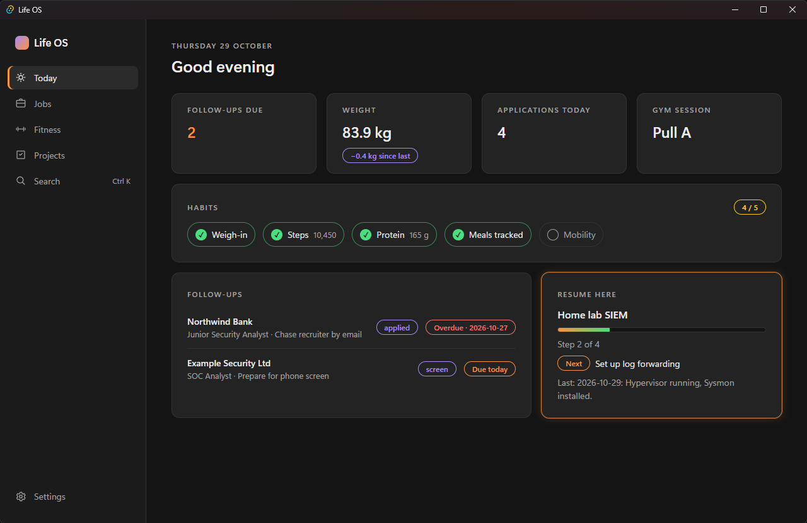
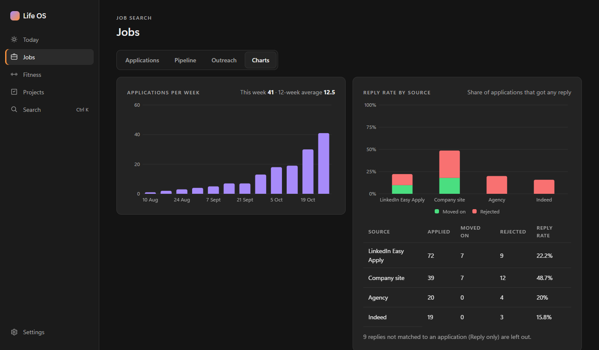

# lifeos-app

A Windows desktop app for a Markdown + YAML "Life OS" note vault (Obsidian-compatible). It shows progress dashboards for daily habits, fitness, job search and personal projects, and lets you view and edit the notes without replacing Obsidian.

> Status: phase 1 (foundation): app shell, vault connection and the Today page. Jobs, Fitness, Projects, editor and search follow in phases 2 to 4.





## Highlights

- **Local-first.** Your notes stay the source of truth; a disposable SQLite index makes dashboards fast. No telemetry.
- **Least privilege.** The UI has no direct file system, shell or network access; all vault access goes through a path-guarded Rust core.
- **Secure pipeline.** Every pull request runs format, lint, type and unit checks plus CodeQL, Semgrep, dependency audits and secret scanning. Releases ship with an SBOM, checksums and build provenance.

## Stack

Tauri 2 (Rust) · TypeScript · React · Vite · SQLite · Vitest · Playwright

## Docs

- [Architecture decision records](docs/adr/)
- [Threat model](docs/threat-model.md)
- [Phase 1 plan](docs/phase-1-plan.md)
- [Security policy](SECURITY.md)

## Building from source

Requirements: Windows 10/11, Node 26 LTS, pnpm, Rust (stable, MSVC), Visual Studio Build Tools (C++ workload).

```bash
pnpm install
pnpm tauri dev          # run the app
pnpm test               # UI unit tests
pnpm e2e                # end-to-end tests (after: pnpm tauri build --debug --no-bundle)
cd src-tauri && cargo test
```

## Verifying a release

Each release includes `SHA256SUMS.txt`, a CycloneDX SBOM and build provenance:

```bash
gh attestation verify Life.OS_0.1.0_x64-setup.exe --repo atharva-acharya/lifeos-app
```

Installers are not yet Authenticode-signed (see [ADR 0005](docs/adr/0005-release-signing.md)), so Windows SmartScreen may warn on first run.

## Licence

[MIT](LICENSE)
